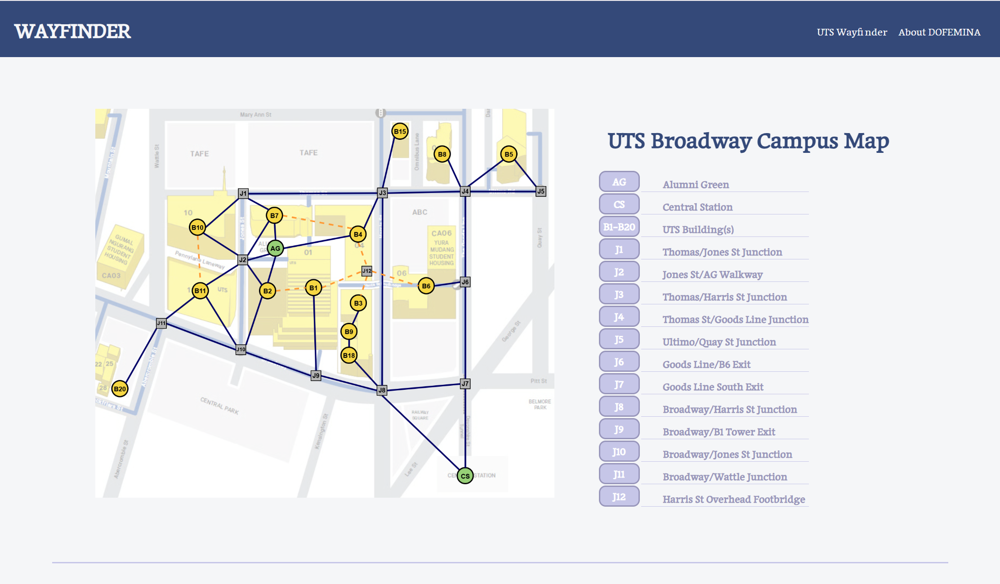
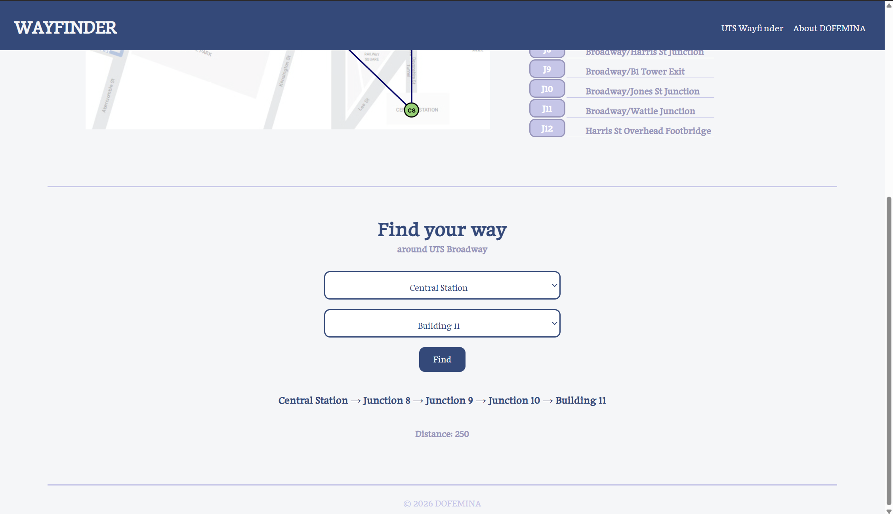

# UTS-Wayfinder: An AI-based Campus Route Planner
By Dofemina

UTS Wayfinder is a platform aimed to help users find the best path from their starting point to their destination in UTS Broadway. The platform uses the AI algorithm, A* Search Algorithm, to find the optimal path.

Website Link: [UTS WayFinder]([https://www.uts.edu.au/events/open-day/find-your-way-around-campus])

# Preview



# Features
Through the UTS Wayfinder page, users can select their starting point and destination from the provided locations to find their way around UTS Broadway.

# Tech Stack
- `Python`: Search algorithm and backend logic.
- `NetworkX`: Graph representation.
- `A* Search Algorithm`: Route-finding algorithm.
- `FastAPI`: Connects the Python backend to the website.
- `HTML`: Website structures.
- `CSS`: Website styling.
- `JavaScript`: User interection.
- `Google Fonts`: Website typography.
- `CSV`: Stores node coordinates and fgraph connections.


# Folder Structure
```
css/
├── about.css
├── common.css
├── index.css
└── responsive.css

data/
├── adjacency_matrix.csv
└── nodes.csv

html/
├── about.html
└── index.html

img/
├── Map.png
├── uts-campus-map.png
├── Website-preview1.png
└── Website-preview2.png

js/
└── script.js

python/
├── app.py
└── main.py

README.md
requirements.txt
```

# Installation and Setup
## 1. Clone the Repository
```
git clone <repository-url>
cd uts-wayfinder
```

## 2. Install Dependencies
Make sure Python is installed, then run:
```
python -m pip install -r requirements.txt
```
The main Python libraries used in this project are:
- FastAPI: Connects the frontend to the Python backend.
- Uvicorn: Runs the FastAPI server.
- NetworkX: Represents the campus map as a graph.
- Pandas & NumPy: Process building and route data.
- Matplotlib: Visualises the calculated route.
- Pydantic: Validates API requests.

## 3. Start the Backend
From the project root directory, run:
```
python -m uvicorn app:app --reload --app-dir python
```
The API will be available at: `http://127.0.0.1:8000`

## 4. Open the Website
Open html/index.html using VS Code Live Server.
The website will connect to the FastAPI backend to calculate and display routes between UTS buildings.

> Note: Keep the backend server running while using the website.

# Limitations
- The campus is represented as a simpilified graph of buildings and junctions.
- Routes depend on the predefined connection and distances.

# Future Plans
- Improve the interactive map interface.
- Add more campus locations and pathways.
- Improve route visualisation and user experience.

# Map Attribution
The campus mp is the adapted from an existing UTS campus map. All buildings and junction nodes were added for the academic project purpose.

Original map source: [UTS Website](https://www.uts.edu.au/events/open-day/find-your-way-around-campus)

The map is used for educational purposes. All right remain with the orinal copyrigh

# Author
**Dofemina**

### Developers
[@Meerab-K](https://github.com/Meerab-K) and [@JiajyStudio](https://github.com/JiajyStudio)

### Other team members
Dofemnia consists of two other team members who were responsible for the completion of assignment report.

# License
This project is for UTS group assignment in 41040 Introduction to Artificial Intelligence.


